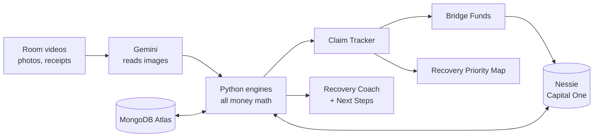

# Aftershock

**Prove it. Fund it. Navigate it. No one overlooked.**

After a disaster, families lose more than their home. They lose what they can't prove, what they never claim, and what they waste while waiting. Aftershock proves what a family lost, gets them every dollar they're owed, puts money in their hands before the claim pays, and guides every money decision until it does.

Built at **HackUTD 2026**.

---

## The three pillars

| Pillar | Sponsor challenge | What it answers |
|---|---|---|
| **Prove it** | State Farm: *The Worst Day, at Scale* | What did I lose, what am I owed, and who needs help first? |
| **Fund it** | Capital One: *Best use of Nessie: reimagine banking* | How do I get money now, before the claim pays? |
| **Navigate it** | PNC: *360° Financial Health Navigator* | What do I have, where do I go, what do I do next, and can I afford this? |

### Prove it (State Farm)
- **Room Scanner:** the family records a short video of each room before a disaster and again after. Gemini lists every item with its condition and value range. Code works out replacement cost and actual cash value, then compares before and after to build a loss list with proof frames.
- **Quality checks (OpenCV):** blur and brightness checks ask the user to slow down or add light; Gemini points out places it didn't see ("I didn't see the closet").
- **Claim Tracker:** belongings, home damage photos and receipts in one place. For extra living expenses, only costs above the family's normal spending count (from their Nessie purchase history).
- **Recovery Priority Map:** ranks thousands of households by financial urgency so adjusters and Bridge Funds reach the most urgent first. Scored on loss severity (40), financial fragility (30, opt-in) and silence (30: no claim filed, no contact, unanswered outreach). Scores only go up, never down, and responders see reasons, never balances.

### Fund it (Capital One, on Nessie)
- **Bridge Funds:** a documented claim unlocks cash in minutes (the lesser of 40% of documented losses or 60 days of essential spending, capped at $5,000), repaid automatically when the insurance payout lands.
- **Disaster Mode:** labels every bill due before the claim pays as *pay now*, *move* or *call about*, pauses late fees, and sorts spending into essential vs. can-wait.
- **Help Circle:** family and friends send money through Nessie P2P transfers.
- **Cash Access:** the nearest working ATM, skipping ones knocked out in the disaster zone.

### Navigate it (PNC)
- **Recovery Coach:** a conversational coach that answers "What do I have?", "Where do I go?" and "Can I afford a hotel for two weeks?" Every answer shows its assumptions and ends with one next step.
- **Next Steps card:** the 3 most important actions right now, updated whenever anything changes.
- **Eight account types** in one view: checking, savings, CD, IRA, credit card, auto loan, personal loan, mortgage.
- **Four health indicators:** runway, deductible coverage, bills at risk, debt pressure.
- **Money Ladder:** which money to use first and which to protect (Bridge Funds → checking/savings → mortgage pause → credit card for essentials → protect the CD → protect the IRA).
- **Forecast and what-if simulator:** day-by-day balance until the claim pays, with the tight day marked. Try "claim takes 6 weeks", "insurance pays 70%" or "I miss two weeks of work".

---

## How it fits together



**Rule:** all scoring, valuations, forecasts and money math live in Python code. Gemini only reads images and rewrites explanations in plain language; it never decides amounts.

---

## Tech stack

| Layer | Technology |
|---|---|
| Backend | Python, FastAPI |
| AI | Google Gemini (video, photo and receipt reading; coach wording) |
| Computer vision | OpenCV (blur and brightness checks, frame extraction) |
| Banking | Capital One Nessie API v2 |
| Database | MongoDB Atlas (geospatial queries for the map and ATMs) |
| Hosting | Vultr |
| Frontend | Next.js + Tailwind, maps with Leaflet + OpenStreetMap (in progress) |

---

## Run it locally

```bash
cd backend
python3 -m venv .venv
./.venv/bin/pip install -r requirements.txt
cp .env.example .env     # add your keys (optional, see below)
./.venv/bin/uvicorn app.main:app --reload --port 8000
```

Open **http://localhost:8000/docs** to try every endpoint.

**Keys are optional.** Any key left blank switches that service to a built-in mock, so the whole app runs offline:

| Variable | Where to get it |
|---|---|
| `GEMINI_API_KEY` | Google AI Studio |
| `NESSIE_API_KEY` | v2.nessieisreal.com |
| `MONGODB_URI` | MongoDB Atlas (free cluster) |

Run the tests with `./.venv/bin/python -m pytest -q`. Reset the demo data with `POST /demo/reset`.

---

## Project structure

```
backend/
  app/
    engine/      money math: valuation, before/after compare, claim, Bridge Funds,
                 Disaster Mode, forecast, health indicators, Money Ladder,
                 Next Steps, Recovery Priority
    services/    Gemini, OpenCV checks, Nessie client, Recovery Coach
    routers/     prove.py (State Farm), fund.py (Capital One),
                 navigate.py (PNC), insurer.py (priority map)
    data/        the demo family (the Garcias) and 2,000 synthetic Dallas County households
  tests/         end-to-end demo flow
PLAN.md          full project plan and demo script
```

See [backend/README.md](backend/README.md) for the full endpoint list.

---

## The demo family: the Garcias

A synthetic family in Dallas after a flood: $640 checking, $900 savings, a $5,000 CD, a $14,000 IRA, a $2,500 deductible, and a claim expected in 3 weeks. They start at the top of the insurer's priority map ("Large contents loss, no claim started, 6 days of savings"), unlock Bridge Funds, and the coach walks them through every decision until the payout arrives.

---

## Honest notes
- Bridge Funds and Disaster Mode are **Nessie simulations** of what a bank and insurer could build together.
- Item values are **estimates**, and insurance rules such as extra living expenses and replacement cost vary by policy.
- Financial signals on the priority map are **opt-in**, shown as reasons instead of balances, and only ever move people up.
- All households and financial data are **synthetic**.
