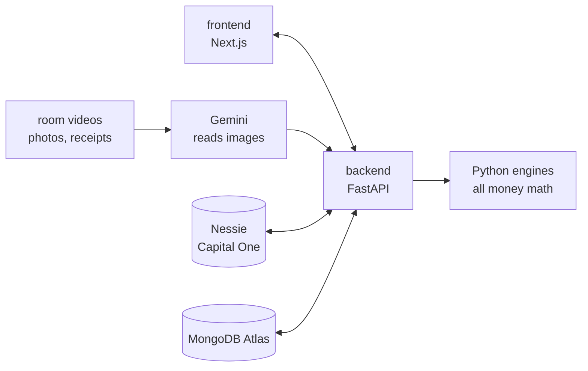

# looma.

**your calm after the storm.**

After a disaster, families lose more than their home. They lose what they can't prove, what they never claim, and what they waste while waiting. looma helps families recover financially: prove what they lost, get money before the claim pays, and know exactly what to do next.

*Prove it. Fund it. Navigate it. No one overlooked.*

Built at **HackUTD 2026**.

---

## The three pillars

| Pillar | Sponsor challenge | What it answers |
|---|---|---|
| **prove it** | State Farm: *The Worst Day, at Scale* | What did I lose, what am I owed, and who needs help first? |
| **fund it** | Capital One: *Best use of Nessie: reimagine banking* | How do I get money now, before the claim pays? |
| **navigate it** | PNC: *360° Financial Health Navigator* | What do I have, where do I go, what do I do next, and can I afford this? |

### prove it (State Farm)
- **Room Scanner:** the family records a short video of each room before a disaster and again after. Gemini lists every item with its condition and value range. Code works out replacement cost and actual cash value, then compares before and after to build a loss list with proof frames.
- **Quality checks (OpenCV):** blur and brightness checks ask the user to slow down or add light, and Gemini points out places it didn't see ("I didn't see the closet").
- **Claim Tracker:** belongings, home damage photos and receipts in one place. For extra living expenses, only costs above the family's normal spending count (from their Nessie purchase history).
- **Recovery Priority (lantern):** the responder view ranks thousands of households by financial urgency so adjusters and Bridge Funds reach the most urgent first. Scored on loss severity (40), financial fragility (30, opt-in) and silence (30: no claim filed, no contact, unanswered outreach). Scores only go up, never down, and responders see reasons, never balances.

### fund it (Capital One, on Nessie)
- **Bridge Funds:** a documented claim unlocks cash in minutes (the lesser of 40% of documented losses or 60 days of essential spending, capped at $5,000), repaid automatically when the insurance payout lands.
- **Disaster Mode / bills:** labels every bill due before the claim pays as *pay now*, *move* or *call about*, pauses late fees, and sorts spending into essential vs. can-wait.
- **Help Circle:** family and friends send money through Nessie P2P transfers.
- **Cash Access:** the nearest working ATM, skipping ones knocked out in the disaster zone.

### navigate it (PNC)
- **Ask looma (Recovery Coach):** answers "What do I have?", "Where do I go?" and "Can I afford a hotel for two weeks?" Every answer shows its assumptions and ends with one next step.
- **Today / Next Steps:** the most important actions right now, updated whenever anything changes.
- **My money:** eight account types in one view (checking, savings, CD, IRA, credit card, auto loan, personal loan, mortgage) and four health indicators (runway, deductible coverage, bills at risk, debt pressure).
- **Money Ladder:** which money to use first and which to protect (Bridge Funds → checking/savings → mortgage pause → credit card for essentials → protect the CD → protect the IRA).
- **What if:** day-by-day balance until the claim pays with the tight day marked. Try "claim takes 6 weeks", "insurance pays 70%" or "I miss two weeks of work".

---

## How it fits together



**Rule:** all scoring, valuations, forecasts and money math live in Python code. Gemini only reads images and rewrites explanations in plain language; it never decides amounts.

---

## Tech stack

| Layer | Technology |
|---|---|
| Frontend | Next.js 15, React 19, Tailwind CSS 4, Motion, Lucide icons |
| Backend | Python, FastAPI |
| AI | Google Gemini (video, photo and receipt reading; coach wording) |
| Computer vision | OpenCV (blur and brightness checks, frame extraction) |
| Banking | Capital One Nessie API v2 |
| Database | MongoDB Atlas (geospatial queries for the priority map and ATMs) |
| Hosting | Vultr |

---

## Run it

Both halves run on their own. The frontend falls back to mock data if the backend is off, and the backend falls back to mocks for any API key you leave blank.

### Backend

```bash
cd backend
python3 -m venv .venv
./.venv/bin/pip install -r requirements.txt
cp .env.example .env     # add your keys (optional)
./.venv/bin/uvicorn app.main:app --reload --port 8000
```

Open **http://localhost:8000/docs** to try every endpoint.

| Variable | Where to get it |
|---|---|
| `GEMINI_API_KEY` | Google AI Studio |
| `NESSIE_API_KEY` | v2.nessieisreal.com |
| `MONGODB_URI` | MongoDB Atlas (free cluster) |

Tests: `./.venv/bin/python -m pytest -q`. Reset demo data: `POST /demo/reset`.

### Frontend

```bash
cd frontend
npm install
cp .env.example .env.local   # NEXT_PUBLIC_API_URL=http://localhost:8000 (leave unset for mock data)
npm run dev
```

Open http://localhost:3000 on a laptop. Press Enter to begin, then use ← → to move through the story (great for demos). Deep links work too: `/#scan`, `/#fund`, `/#lantern`. **Shift+D** opens demo controls.

---

## Frontend

### Structure
- **Landing site** (`scenes/Title.tsx`): light page with thin grid lines, animated logo, nav dropdowns with live illustrations, and a phone mockup playing a Bridge Funds moment. Press Enter or "open looma".
- **The app** (`LoomaApp.tsx`): dark shell with a glass sidebar and one focused page at a time in the content pane.
  - today · one thing to do now (`Today.tsx`)
  - prove it · scan a room (`Scan.tsx`), what changed (`Compare.tsx`), my claim (`Claim.tsx`)
  - fund it · bridge funds (`Fund.tsx`: numpad → swipe → card reveal), bills (`Bills.tsx`: one bill at a time), help circle (`Circle.tsx`)
  - navigate it · ask looma (`Ask.tsx`), my money (`Picture.tsx`: one question per tab), what if (`Wait.tsx`)
- **Responder view** (`Lantern.tsx`): dark console for insurers.

Steps completed anywhere check off on the today page. ← → walks the app in order.

### Design system
- Palette: midnight `#1C2E4A`, dusty blue `#52677D`, ivory `#BDC4D4`, deep navy `#0F1A2B`, buttercream `#D1CFC9`.
- Type: Outfit (light for headlines), all lowercase headlines.
- Utilities in `globals.css`: `glass`, `pill-dark`, `pill-light`, `eyebrow`, `headline`.
- Mascot: `components/Logo.tsx` (wordmark, drawn as geometry so the o's are true rings) and `components/Cat.tsx` (avatar + `LoomaSays`).
- No company names anywhere in the UI.

### Code map
- `src/lib/types.ts`: shared data shapes.
- `src/lib/mock.ts`: Garcia data, forecast model, synthetic households.
- `src/lib/api.ts`: API client; every call falls back to mock data (also the live-demo fallback).

---

## Backend

```
backend/app/
  engine/      money math: valuation, before/after compare, claim, Bridge Funds,
               Disaster Mode, forecast, health indicators, Money Ladder,
               Next Steps, Recovery Priority
  services/    Gemini, OpenCV checks, Nessie client, Recovery Coach
  routers/     prove.py (State Farm), fund.py (Capital One),
               navigate.py (PNC), insurer.py (priority map)
  data/        the Garcias and 2,000 synthetic Dallas County households
backend/tests/ end-to-end demo flow
```

### Main endpoints (household id `garcia`)

| Screen | Endpoint |
|---|---|
| today | `GET /households/garcia` (includes `next_steps`), `GET /households/garcia/next-steps` |
| scan a room | `POST /households/garcia/scan` (form: `room`, `phase=before\|after`, `video`) |
| what changed / my claim | `GET /households/garcia/items`, `GET /households/garcia/claim`, `POST /households/garcia/losses/review` |
| bridge funds | `GET /households/garcia/bridge`, `POST /households/garcia/bridge/disburse` |
| bills | `GET /households/garcia/bills` |
| help circle | `POST /households/garcia/help-circle` `{"from_name", "amount"}` |
| ask looma | `POST /households/garcia/coach` `{"question"}` → `{"answer", "next_step", ...}` |
| my money | `GET /households/garcia/accounts`, `GET /households/garcia/health`, `GET /households/garcia/ladder` |
| what if | `GET /households/garcia/what-if?claim_delay_days=42&payout_pct=0.7&missed_work_days=10` |
| lantern | `GET /insurer/households` |

Full list in [backend/README.md](backend/README.md) and at `/docs`.

### How the frontend talks to the backend
`frontend/src/lib/api.ts` calls the endpoints above and converts the backend's snake_case replies into the shapes in `src/lib/types.ts`. If `NEXT_PUBLIC_API_URL` is unset or a call fails, it returns mock data instead.

| `api.*` | Backend endpoint |
|---|---|
| `household()` | `/households/{id}` + `/accounts`, `/bills`, `/health`, `/claim`, `/bridge` |
| `nextSteps(id, scenario?)` | `GET /households/{id}/next-steps?claim_delay_days=&payout_pct=&missed_work_days=` |
| `items()` | `GET /households/{id}/items` (proof frames via `/frame`) |
| `priority()` | `GET /insurer/households` (score split into severity / fragility / silence) |
| `unlockBridgeFunds()` | `POST /households/{id}/bridge/disburse` |
| `coach(id, message)` | `POST /households/{id}/coach` `{ question }` |

### Live data in the app
`src/lib/live.tsx` loads the household once from the backend and refreshes it after every action, so every screen shows the same live numbers: today, scan (real video upload → OpenCV + Gemini), claim, bridge funds, bills, help circle and ATMs, ask looma, my money, what if, and the lantern. Story steps (filing the claim, a receipt, Ana's $200, paying a bill, the mortgage call) post to the backend, which mirrors money moves to Nessie. **Shift+D → Reset demo** also resets the backend.

If the backend isn't reachable, every screen falls back to the scripted mock story in `src/lib/mock.ts` and `src/lib/demoData.ts`. The before/after illustration on **what changed** stays scripted.

---

## The demo family: the Garcias

A synthetic family in Dallas after a flood: $640 checking, $900 savings, a $5,000 CD, a $14,000 IRA, a $2,500 deductible, and a claim expected in 3 weeks. They start at the top of the responder view ("Large contents loss, no claim started, 6 days of savings"), unlock Bridge Funds, and looma walks them through every decision until the payout arrives. The full demo script is in [PLAN.md](PLAN.md).

---

## Honest notes
- Bridge Funds and Disaster Mode are **Nessie simulations** of what a bank and insurer could build together.
- Item values are **estimates**, and insurance rules such as extra living expenses and replacement cost vary by policy.
- Financial signals on the priority map are **opt-in**, shown as reasons instead of balances, and only ever move people up.
- All households and financial data are **synthetic**.
